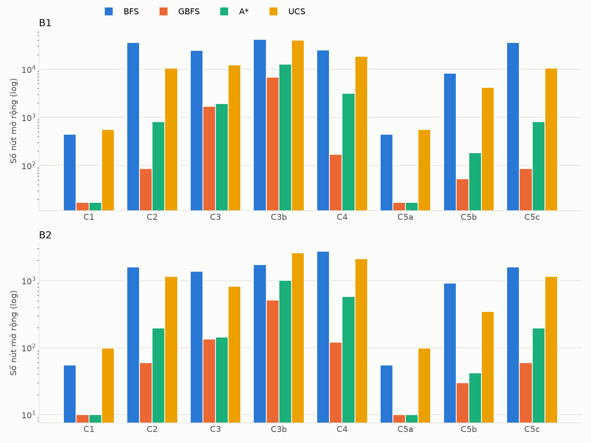
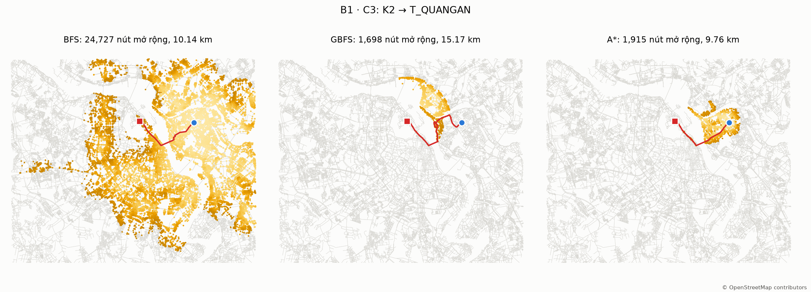

# Hanoi Delivery Search — So sánh BFS, GBFS và A\* trên bản đồ Hà Nội

Tìm đường từ **kho** đến **khách hàng** trên bản đồ thật của Hà Nội (OpenStreetMap) bằng **BFS**, **Greedy Best-First Search (GBFS)** và **A\***, dùng **UCS/Dijkstra** làm đáp án chuẩn. So sánh số nút mở rộng và chiều dài đường đi trên ba đồ thị:

| Đồ thị | Mức | Nút | Cạnh có hướng | Dùng để |
|---|---|---|---|---|
| **A** | 12 quận nội thành cũ | 12 | 30 (15 cạnh vô hướng) | Chạy tay từng bước |
| **B1** | Mạng chi tiết cho ô tô (`drive`) | 56 348 | 138 445 | So sánh trên mạng dày |
| **B2** | Mạng trục chính | 3 890 | 7 027 | So sánh trên mạng thưa |

Số cạnh là sau khi gộp cạnh song song và bỏ self-loop. Chi phí là quãng đường tính bằng mét; không xét thời gian hay tắc đường.

Tài liệu: [đặc tả và các sai khác khi cài đặt](docs/design.md), [hạn chế](docs/limitations.md), [bảng kết quả](results/tables/report_tables.md).

## Kết quả chính

Dữ liệu OSM chụp ngày 31/10/2026 (UTC). Có 56 ca trên B1 và 31 ca trên B2 (gồm các ca có tên và đích ngẫu nhiên), cộng 132 cặp quận ở mức A.

| Đồ thị | Thuật toán | Trung vị nút mở rộng | So với UCS (trung vị) | Trung vị gap | Gap lớn nhất | Ca tối ưu |
|---|---|---:|---:|---:|---:|---:|
| B1 | BFS | 21 501 | 132,4% | 32,2% | 122,1% | 5,4% |
| B1 | GBFS | 146 | 1,0% | 34,0% | 73,0% | 5,4% |
| B1 | A\* | 1 892 | 14,5% | 0% | 0% | 100% |
| B1 | UCS | 17 650 | 100% | 0% | 0% | 100% |
| B2 | BFS | 1 742 | 121,9% | 20,6% | 123,9% | 12,9% |
| B2 | GBFS | 71 | 5,7% | 28,9% | 109,4% | 9,7% |
| B2 | A\* | 268 | 21,2% | 0% | 0% | 100% |
| B2 | UCS | 1 513 | 100% | 0% | 0% | 100% |



### Đối chiếu giả thuyết

| Giả thuyết | Kết quả | Số liệu |
|---|---|---|
| **H1.** A\* luôn tối ưu và mở rộng không nhiều hơn UCS | **Đạt** | Gap = 0 ở cả 87 ca và 132 cặp mức A; `reopened` = 0; không ca nào A\* mở rộng nhiều hơn UCS |
| **H2a.** GBFS mở rộng ít nhất ở phần lớn ca | **Đạt** | 98,9% số ca (tính cả hòa) |
| **H2b.** Gap của GBFS tăng theo tỉ lệ vòng | **Chỉ yếu** | Mọi ca: ρ = 0,37 (p = 0,006) trên B1, ρ = 0,26 (p = 0,18) trên B2. Riêng đích ngẫu nhiên: ρ = 0,25 (p = 0,09) và ρ = −0,03 (p = 0,91) |
| **H3a.** BFS không tối ưu ở phần lớn ca | **Đạt** | 92% số ca có gap > 0 |
| **H3b.** Gap của BFS lớn nhất ở C4 | **Không đạt** | C4 là 46,3% (B1) và 21,9% (B2); lớn nhất là 122,1% ở R26 và 123,9% ở R14 |
| **H4a.** Số nút mở rộng tăng theo khoảng cách | **Đạt** | Hệ số góc log–log đều dương, từ 1,15 đến 2,05 |
| **H4b.** BFS, UCS tăng nhanh hơn A\* | **Không đạt** | B1: A\* 2,05, UCS 1,66, BFS 1,62. B2: A\* 1,82, BFS 1,73, UCS 1,65 |
| **H4c.** B1 mở rộng nhiều hơn B2 | **Đạt** | Trên 23 đích chung: gấp 8,0 lần (BFS), 7,9 (UCS), 5,6 (A\*), 1,9 (GBFS) |

Về H4b: A\* vẫn mở rộng ít nút hơn nhiều ở mọi khoảng cách, nhưng tỉ lệ tiết kiệm giảm dần khi đích xa hơn. Ví dụ trên B1, A\*/UCS là 3% ở C5a (1,7 km), 4% ở C5b (4,6 km) và 8% ở C5c (7,8 km).

Ca C3 (K2 → Quảng An, phải qua sông Hồng) cho thấy rõ cái bẫy của GBFS trên B1: GBFS mở rộng 1 698 nút nhưng đi 15,17 km, A\* mở rộng 1 915 nút và đi 9,76 km.



**Mức A:** BFS tối ưu ở cả 132 cặp, GBFS tối ưu ở 83,3% (gap lớn nhất 38,3%). Cả hai ứng viên chạy tay ở đặc tả đều cho GBFS trùng A\*, nên notebook 02 dùng cặp TX → CG: GBFS đi 13,0 km, A\* đi 9,4 km.

**Kịch bản nhiều điểm dừng M1:** chọn khách gần nhất theo chim bay hay theo đường bộ đều ra **cùng một thứ tự**, nên không quan sát được khác biệt mong đợi với năm khách này. Tổng 42,6 km trên B1; A\* mở rộng 7 314 nút so với 49 282 của UCS.

**Về heuristic:** cài đặt dùng `haversine` thay vì `euclid_utm`, vì đo trên dữ liệu thật cho thấy `euclid_utm` không consistent trên khoảng 20% số cạnh. Xem [mục 2.2 của đặc tả](docs/design.md#22-vì-sao-euclid-trên-utm-thỏa-cả-hai-điều-kiện).

## Cài đặt

Đã chạy với Python 3.14. Phiên bản thư viện được ghim trong `requirements.txt`.

```bash
python3 -m venv .venv
source .venv/bin/activate            # Windows: .venv\Scripts\activate
pip install -r requirements.txt
```

Tải ranh giới hành chính Việt Nam từ GADM (gadm.org → Download → Vietnam → **Geopackage**), đặt thành `data/external/gadm41_VNM.gpkg`. Không dùng bản JSON cấp 2 vì ranh giới các quận không trùng khít.

## Chạy

```bash
pytest -q tests/test_toy_graphs.py tests/test_counting.py tests/test_determinism.py

python scripts/01_download.py --dataset all          # vài phút; đã có snapshot thì bỏ qua, trừ khi --force
python scripts/02_preprocess.py --dataset all
python scripts/03_build_district_graph.py
python scripts/04_select_cases.py --dataset all
python scripts/05_run_benchmark.py --dataset all
python scripts/06_make_figures.py --only all
python scripts/07_multi_stop.py --scenario M1

pytest -q                                            # toàn bộ test; test trên đồ thị thật tự skip nếu chưa có dữ liệu
```

| Thư mục | Nội dung |
|---|---|
| `results/tables/` | `runs.csv`, `runs_A.csv` là bảng gốc; `summary*.csv`, `cases.csv`, `multistop.csv`, `report_tables.md` |
| `results/figures/` | Biểu đồ và hình vùng mở rộng |
| `results/maps/` | Bản đồ HTML tương tác: bật/tắt từng thuật toán, tỉ lệ vòng, tour M1 |
| `notebooks/` | `01` kiểm tra dữ liệu, `02` bảng chạy tay mức A, `03` trả lời RQ1–RQ4 |

## Giấy phép dữ liệu

- **OpenStreetMap:** dữ liệu theo giấy phép ODbL. © OpenStreetMap contributors.
- **GADM:** miễn phí cho mục đích học thuật và phi thương mại, không được phân phối lại. File không nằm trong repo, cần tải theo hướng dẫn trên.
